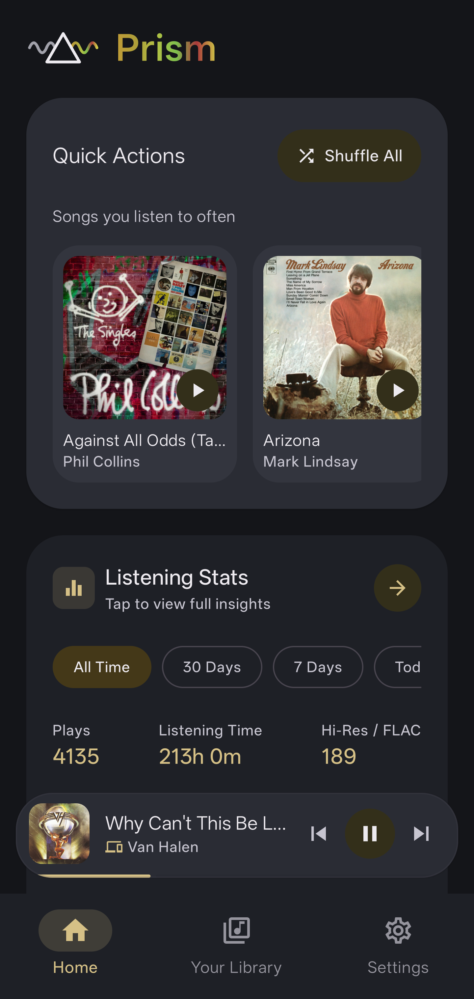
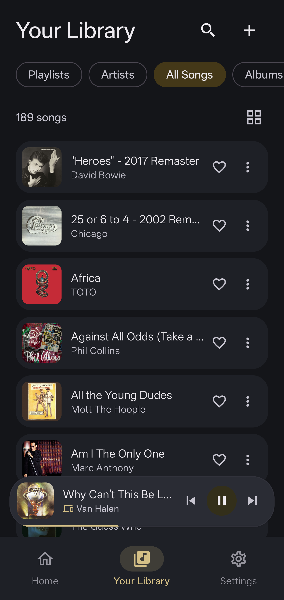
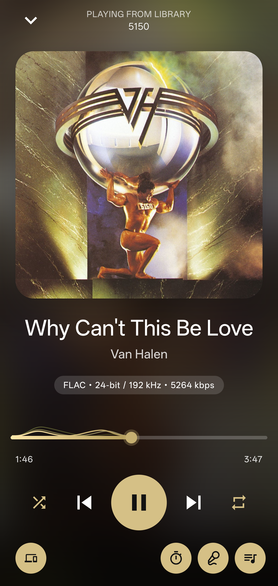
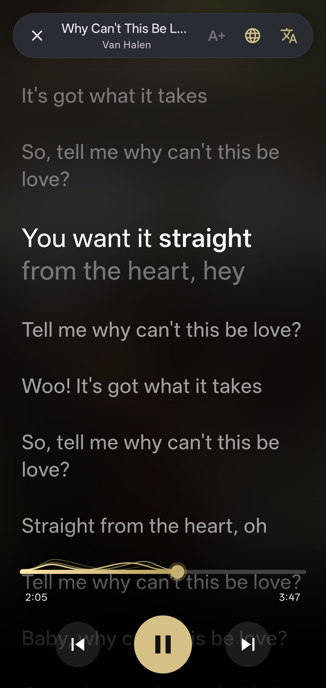
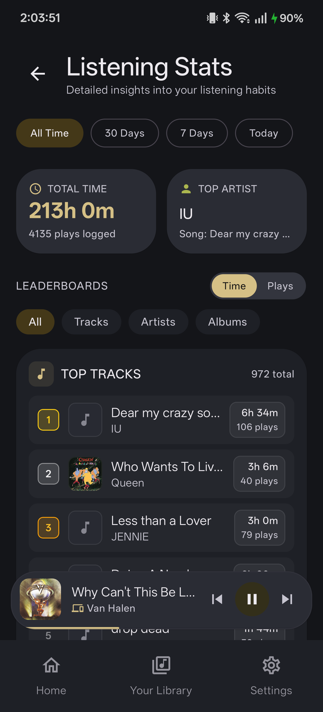
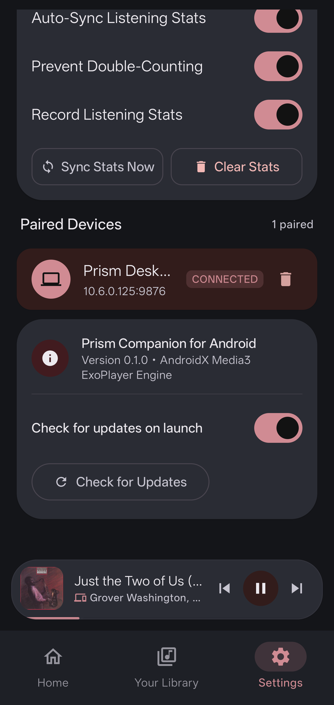
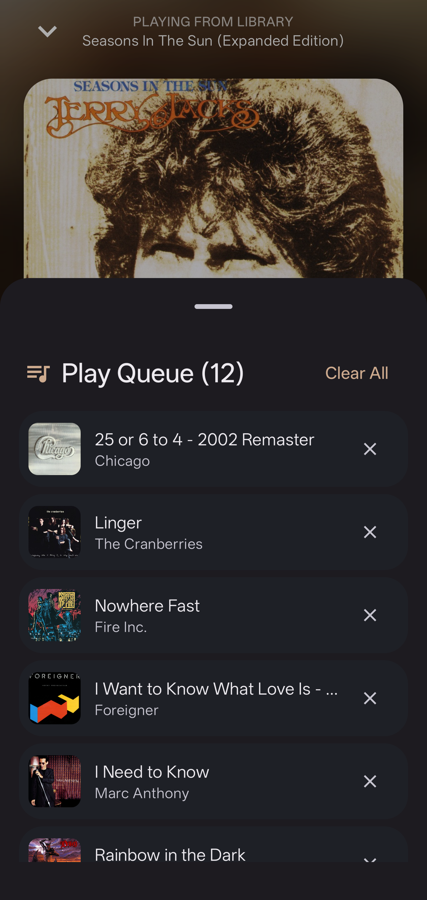
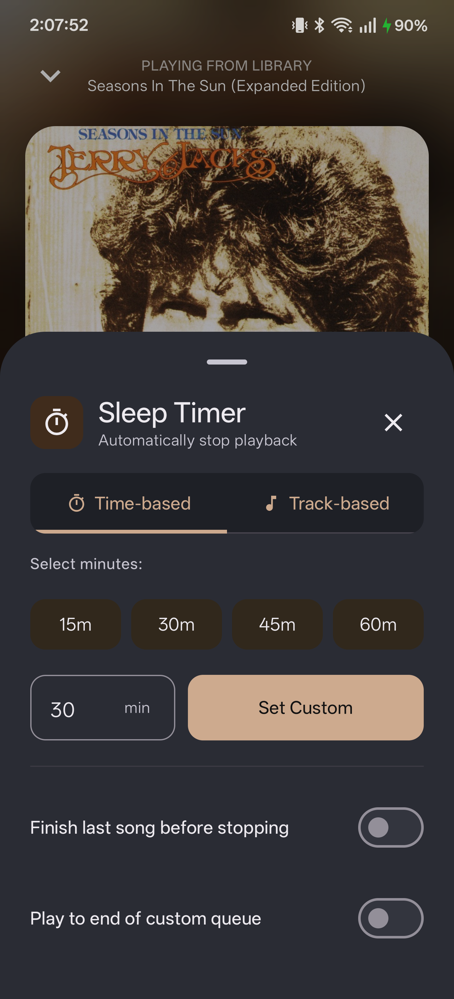

# Prism Android Music Player

<div align="center">

[](https://developer.android.com/)
[](https://kotlinlang.org/)
[](https://developer.android.com/jetpack/compose)
[](https://developer.android.com/media/media3)
[](LICENSE)

**A high-fidelity local music player, synchronized lyrics renderer, and LAN companion controller for Android.**

*Built with AndroidX Media3 (ExoPlayer), Jetpack Compose, Material Design 3, and P2P WebSocket Sync.*

</div>

---

## Table of Contents

- [Overview](#overview)
- [Interface Showcase](#interface-showcase)
- [Architecture and Core Systems](#architecture-and-core-systems)
  - [Audio Playback Engine](#audio-playback-engine)
  - [Dynamic Artwork Theming and Visuals](#dynamic-artwork-theming-and-visuals)
  - [Synchronized Lyrics Engine](#synchronized-lyrics-engine)
  - [Desktop Companion and LAN Synchronization Protocol](#desktop-companion-and-lan-synchronization-protocol)
  - [Local Listening Statistics and Analytics](#local-listening-statistics-and-analytics)
  - [Media Library and Storage Management](#media-library-and-storage-management)
- [Tech Stack](#tech-stack)
- [Getting Started](#getting-started)
  - [Prerequisites](#prerequisites)
  - [Building from Source](#building-from-source)
  - [Running Unit Tests](#running-unit-tests)
- [Related Repositories](#related-repositories)
- [License](#license)

---

## Overview

Prism Android is a modern, standalone local audio player designed for audiophile-grade playback and direct ecosystem synchronization with [Prism Desktop](https://github.com/secondjb/Prism-Music-Player).

Key capabilities:
- **Direct Local Playback**: Native media playback powered by AndroidX Media3 (ExoPlayer) with automatic audio focus handling, gapless track transitions, and headset disconnection safety.
- **Embedded Tag Extraction**: Extracts FLAC Vorbis comments, ID3v2 tags, embedded sample rates, bit depths, and bitrates to display real-time audio quality badges (such as `FLAC · 24-bit / 192 kHz · 5264 kbps`).
- **Real-Time Dynamic Theming**: Uses AndroidX Palette to sample dominant, vibrant, and muted tones directly from current album artwork, dynamically tinting the entire UI, glassmorphic player backgrounds, and wave components.
- **Syllable and Line Synced Lyrics**: Parses embedded USLT/Vorbis lyrics, local `.lrc` and `.ttml` sidecar files, and pulls from LRCLIB with full romanization and English translation support.
- **P2P Companion Sync**: Pairs with Prism Desktop over local Wi-Fi (mDNS discovery or QR code scanner) or USB reverse proxy. Enables seamless playback handover, dual-device volume/queue sync, and remote desktop playback control.
- **Listening Analytics Engine**: Locally tracks play counts, total listening time, and format metrics with customizable period filters and leaderboard views without external telemetry.

---

## Interface Showcase

| Home Dashboard | Music Library | Now Playing |
| :---: | :---: | :---: |
|  |  |  |
| *Quick actions, listening stats cards, and floating mini player.* | *Indexed tracks, albums, artists, fast-scroller, and favorite toggles.* | *Color-extracted artwork background, audio badges, and wavy seekbar.* |

| Synchronized Lyrics | Listening Analytics | Settings & Preferences |
| :---: | :---: | :---: |
|  |  |  |
| *Line-by-line highlight, font size scaling, translation, and romanization.* | *Total playback time, plays logged, top artist, and leaderboards.* | *Storage rules, audio engine options, companion sync, and update checker.* |

| Play Queue Sheet | Sleep Timer Modal |
| :---: | :---: |
|  |  |
| *Queue management, reordering, and item removal.* | *Time-based and track-based countdown with finish-song options.* |

---

## Architecture and Core Systems

```
+-----------------------------------------------------------------------------------+
|                        Jetpack Compose Presentation Layer                         |
|                                                                                   |
|  [MainActivity.kt] App Scaffolding, Navigation Coordinator, Audio Engine Binding  |
|     |-- [LibraryScreen.kt] Playlists, Artists, Songs with FastScrollbar           |
|     |-- [NowPlayingScreen.kt] Fullscreen Player (Fluid Art, WavySeekBar, Badges)  |
|     |-- [FullScreenLyricsPage.kt] Synced Lyrics, Translations, Romanization       |
|     |-- [StatsScreen.kt] Listening Analytics (Time vs Plays Leaderboards)         |
|     `-- [SettingsScreen.kt] Companion Pairing, Folder Indexing, Storage Toggles   |
|                                                                                   |
|  Theming: [PaletteHelper.kt] Material 3 Dynamic Palette from Album Art            |
+-----------------------------------------▲-----------------------------------------+
                                          | StateFlow / Coroutines
+-----------------------------------------▼-----------------------------------------+
|                               Core Subsystems & Services                          |
|                                                                                   |
|  [LocalPlaybackEngine.kt] AndroidX Media3 / ExoPlayer Engine                      |
|     |-- Gapless transitions, audio focus management, notification service         |
|     `-- [SleepTimerManager.kt] Time, track, and end-of-queue pause triggers       |
|                                                                                   |
|  [LanWebSocketSyncTransport.kt] WebSocket Client + NsdDiscoveryManager (mDNS)     |
|     |-- SyncFrame protocol: handshake, state_sync, queue_sync, command            |
|     `-- Bidirectional output routing (Phone vs Desktop audio handover)            |
|                                                                                   |
|  Persistence & Data Repositories:                                                 |
|     |-- [MediaStoreAudioRepository.kt] Android MediaStore scanner                 |
|     |-- [AudioTagMetadataExtractor.kt] FLAC/MP3/M4A tag and format badge parser   |
|     |-- [PrismPreferencesRepository.kt] Jetpack DataStore (settings and pairings) |
|     |-- [PlaylistRepository.kt] Custom playlists and favorites                    |
|     `-- [ListeningStatsRepository.kt] Local SQLite analytics logging              |
+-----------------------------------------------------------------------------------+
```

### Audio Playback Engine

- **AndroidX Media3 ExoPlayer**: Direct implementation supporting FLAC, MP3, AAC, M4A, OGG, OPUS, and WAV.
- **Audio Focus**: Automatically ducks or pauses audio when phone calls, navigation prompts, or system alarms occur.
- **Noisy Audio Safeguard**: Automatically pauses playback upon Bluetooth disconnection or wired headset removal (`ACTION_AUDIO_BECOMING_NOISY`).
- **Gapless Playback**: Pre-loads next audio buffer in queue for seamless acoustic transitions.
- **Sleep Timer**: Supports minute countdowns (15m, 30m, 45m, 60m, custom), track completion countdowns, end-of-queue pause, and a "Finish last song before stopping" toggle.

### Dynamic Artwork Theming and Visuals

- **Palette Extraction**: AndroidX Palette samples vibrant and muted tones from active album art.
- **WCAG Contrast Guard**: Colors are automatically adjusted for luminance to preserve high contrast and legibility across dark and light surfaces.
- **Wavy Seekbar**: Custom multi-layered trigonometric sine wave canvas rendering with dynamic frequency shifting during active playback.
- **Fast Scroller**: Alpha-indexed sidebar scroller with 3-second auto-hide and touch-scrubbing.

### Synchronized Lyrics Engine

- **Multi-Source Resolution**: Checks embedded Vorbis comments and ID3 USLT frames first, scans local storage for `.lrc` and `.ttml` sidecar files, and queries LRCLIB as a network fallback.
- **Real-Time Scrolling**: Automatically tracks track playback position and smoothly scrolls the active lyric into view.
- **Romanization and Translation**: Built-in support for synchronized translations and pronunciation romanization for Japanese, Korean, and Chinese tracks.
- **Custom Font Controls**: Live font size scaling persisted across app restarts via DataStore.

### Desktop Companion and LAN Synchronization Protocol

- **Local Discovery**: Uses Network Service Discovery (`NsdManager`) to resolve `_prism-sync._tcp` services broadcast by Prism Desktop on the local network.
- **QR Pairing Scanner**: Built-in CameraX scanner powered by ZXing to instantly pair with desktop instances by scanning host/token QR codes.
- **USB Reverse Proxy**: Fallback mode for high-interference Wi-Fi environments via `127.0.0.1:9876` ADB reverse forwarding.
- **SyncFrame Protocol**: Serialized over WebSocket using `kotlinx.serialization`:
  - `handshake_req` / `handshake_resp`: Authenticates client and server tokens.
  - `state_sync`: Synchronizes track metadata, position, playback state, and duration in real time.
  - `queue_sync`: Synchronizes play queue order and active index.
  - `command`: Dispatches remote actions (`play`, `pause`, `skip_next`, `skip_previous`, `seek`).
  - `stats_sync`: Bidirectionally syncs listening history while preventing duplicate play counts.

### Local Listening Statistics and Analytics

- **Local SQLite Storage**: Stores timestamps, track titles, artists, albums, playback duration, and formats locally without cloud tracking.
- **Aggregation Dimensions**: Filter by All Time, 30 Days, 7 Days, or Today.
- **Leaderboards**: Sort top tracks, artists, and albums by total play counts or accumulated listening hours.

### Media Library and Storage Management

- **Folder Filtering**: Explicitly include or exclude storage folders (e.g., `Music/Favorites` or `Download/Recordings`).
- **Audio Duration Thresholds**: Ignore short ringtones, alerts, or voice memos by filtering out files under 10, 30, or 60 seconds.
- **Format Filtering**: Selectively toggle media types (FLAC, MP3, M4A, WAV, etc.) from the index.

---

## Tech Stack

| Component | Technology |
| :--- | :--- |
| **Language** | Kotlin 2.2.10 |
| **UI Framework** | Jetpack Compose (BOM 2026.02.01) |
| **Design System** | Material Design 3 (Material You Dynamic Theming) |
| **Audio Engine** | AndroidX Media3 (ExoPlayer 1.5.1) |
| **Async & Streams** | Kotlin Coroutines & StateFlow |
| **Local Persistence** | Jetpack DataStore Preferences & SQLite |
| **Image Loading** | Coil Compose 2.7.0 |
| **Networking** | OkHttp 4.12.0 (WebSocket Client) |
| **Serialization** | Kotlinx Serialization JSON 1.7.3 |
| **Camera & QR** | AndroidX CameraX 1.4.1 & ZXing Core 3.5.3 |
| **Local Discovery** | Android NsdManager (mDNS / DNS-SD) |
| **Target SDK** | Android 16 (API 36/37) |
| **Minimum SDK** | Android 8.0 Oreo (API 26) |

---

## Getting Started

### Prerequisites

- Android Studio Ladybug (2024.2+) or newer.
- JDK 17 or JDK 21 installed and configured in your environment.
- Android SDK Platform 36/37 and Build-Tools installed.
- An Android device or emulator running Android 8.0 (API 26) or higher.

### Building from Source

Clone the repository:
```bash
git clone https://github.com/secondjb/Prism-Android-Music-Player.git
cd Prism-Android-Music-Player
```

Build the debug APK:
```bash
./gradlew assembleDebug
```
The output APK is generated at:
`app/build/outputs/apk/debug/app-debug.apk`

Install directly onto a connected device:
```bash
./gradlew installDebug
```

### Running Unit Tests

Run the complete regression test suite:
```bash
./gradlew testDebugUnitTest
```

---

## Related Repositories

- [Prism Desktop Music Player](https://github.com/secondjb/Prism-Music-Player): The desktop counterpart built with Tauri v2, Rust, and React 19.

---

## License

This project is licensed under the [MIT License](LICENSE).
